# Guía desde cero: React + Redux Toolkit + React Router

> **Para quién es:** personas que nunca han programado con React ni con Redux.
> **Qué vas a conseguir:** entender, línea por línea, un proyecto donde **dos páginas distintas comparten el mismo contador**, saber por qué está hecho así, romperlo a propósito y arreglarlo.

> 💡 **Cómo ver los diagramas:** están escritos en *Mermaid*. Se ven solos en GitHub. En VS Code instala la extensión **"Markdown Preview Mermaid Support"** y abre la vista previa con `Ctrl + Shift + V`.

---

## Índice

1. [¿Qué hace este proyecto?](#1-qué-hace-este-proyecto)
2. [El problema que resuelve Redux (y por qué existe)](#2-el-problema-que-resuelve-redux)
3. [La gran analogía: el Banco del Pueblo](#3-la-gran-analogía-el-banco-del-pueblo)
4. [Qué instalar antes de empezar](#4-qué-instalar-antes-de-empezar)
5. [Crear el proyecto paso a paso](#5-crear-el-proyecto-paso-a-paso)
6. [El mapa de carpetas](#6-el-mapa-de-carpetas)
7. [Recorrido línea por línea](#7-recorrido-línea-por-línea)
8. [El viaje completo de un clic](#8-el-viaje-completo-de-un-clic)
9. [Acciones OBLIGATORIAS](#9-acciones-obligatorias)
10. [Acciones PROHIBIDAS](#10-acciones-prohibidas)
11. [Laboratorio: rómpelo y arréglalo](#11-laboratorio-rómpelo-y-arréglalo)
12. [¿Cuándo necesito cada cosa?](#12-cuándo-necesito-cada-cosa)
13. [Ejercicios para practicar](#13-ejercicios-para-practicar)
14. [Glosario](#14-glosario)
15. [Checklist final](#15-checklist-final)

---

## 1. ¿Qué hace este proyecto?

Es una aplicación web pequeña con:

- Un **menú** con tres enlaces: *Inicio*, *Hermano* e *Hijo*.
- Dos **páginas** (Hermano e Hijo), cada una con un número y tres botones: **+1**, **-1** y **reiniciar**.
- **Lo interesante:** si sumas 5 en *Hermano* y luego vas a *Hijo*, **también ves 5**. Las dos páginas comparten el mismo número.

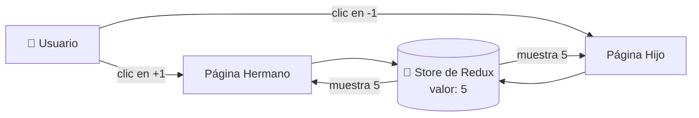

**Por qué es importante:** en React, normalmente cada componente guarda sus propios datos y **no los comparte**. Este proyecto enseña cómo tener **un único lugar** para datos que necesitan muchos componentes.

---

## 2. El problema que resuelve Redux

### 2.1 Sin Redux: el "teléfono descompuesto" (prop drilling)

En React, los datos viajan **de padre a hijo** mediante *props* (como pasar una nota de mano en mano). Si dos componentes que están lejos uno del otro necesitan el mismo dato, hay que subir el dato al ancestro común y bajarlo por todos los intermedios, aunque esos intermedios no lo usen.

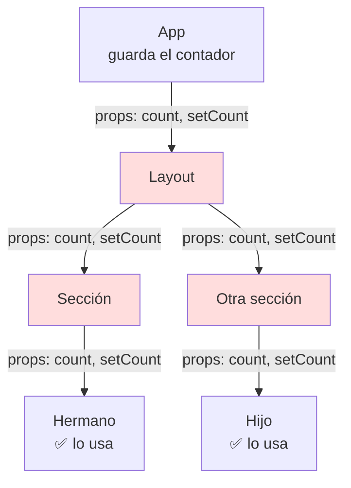

Los cuadros rojos **no necesitan** el contador, pero tienen que cargarlo. Es como pedir a todos los vecinos de un edificio que se pasen una carta piso por piso hasta llegar al 7º.

Además, en **este proyecto** Hermano e Hijo son **páginas distintas**: cuando estás en una, la otra ni siquiera existe en pantalla. Si cada una usara `useState`, el número **se perdería** al cambiar de página.

### 2.2 Con Redux: un buzón central

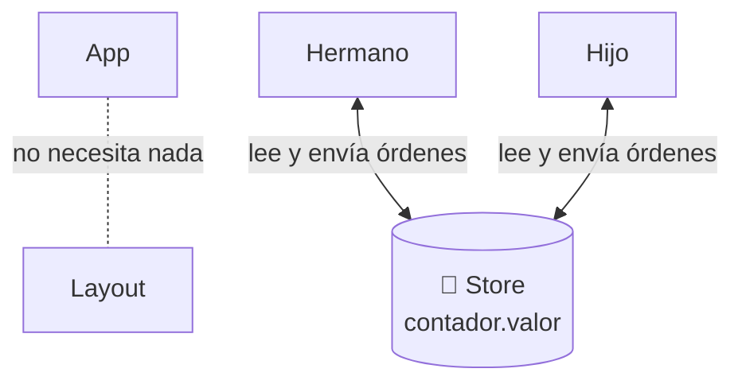

Cada componente que necesita el dato **va directamente al store**. Nadie más se entera ni carga nada.

> **Decisión de diseño:** se usa Redux porque el dato (el contador) lo necesitan **varias páginas** y debe **sobrevivir al cambio de página**. Si solo lo usara un componente, Redux sería excesivo (ver [sección 12](#12-cuándo-necesito-cada-cosa)).

---

## 3. La gran analogía: el Banco del Pueblo

Toda la guía usa esta analogía. Apréndetela, porque cada pieza del código tiene su equivalente:

| Pieza de código | En el Banco del Pueblo | Qué hace de verdad |
|---|---|---|
| **Store** (`store.redux.ts`) | 🏦 La **bóveda** del banco | Guarda **todos** los datos compartidos de la app |
| **Slice** (`counterSlice.redux.ts`) | 🗂️ Un **departamento** del banco (p. ej. "Cuentas de ahorro") | Una parte del estado + las reglas para cambiarla |
| **State** (`{ valor: 0 }`) | 💰 El **saldo** que hay ahora en la cuenta | Los datos en este momento |
| **initialState** | 💵 El saldo con el que **se abre** la cuenta | Valor de arranque |
| **Action** (`incrementar()`) | 📝 Un **formulario** relleno: "Depositar 1" | Un objeto que describe *qué quieres que pase* |
| **Reducer** (`incrementar: state => ...`) | 👩‍💼 El **cajero**, que sigue un manual estricto | Función que recibe el saldo + el formulario y calcula el nuevo saldo |
| **dispatch** | 📮 La **ventanilla** donde entregas el formulario | Envía la acción al store |
| **useSelector / useAppSelector** | 📺 La **pantalla de consulta de saldo** | Lee un dato del store y avisa cuando cambia |
| **Provider** | 🔌 El **cable** que conecta todas las sucursales a la bóveda | Hace que el store esté disponible para todos los componentes |
| **Componente** (`Hermano`, `Hijo`) | 🧍 Un **cliente** | Muestra cosas y pide cambios |
| **React Router** | 🛗 El **ascensor** del edificio | Decide qué "piso" (página) se ve según la URL |
| **Outlet** | 🚪 La **puerta** del ascensor | El hueco donde aparece la página elegida |

**Regla de oro del banco:** un cliente **nunca entra en la bóveda a mover billetes con sus manos**. Rellena un formulario (action), lo entrega en ventanilla (dispatch) y el cajero (reducer) hace el cambio. Así siempre se sabe **quién cambió qué y por qué**.

---

## 4. Qué instalar antes de empezar

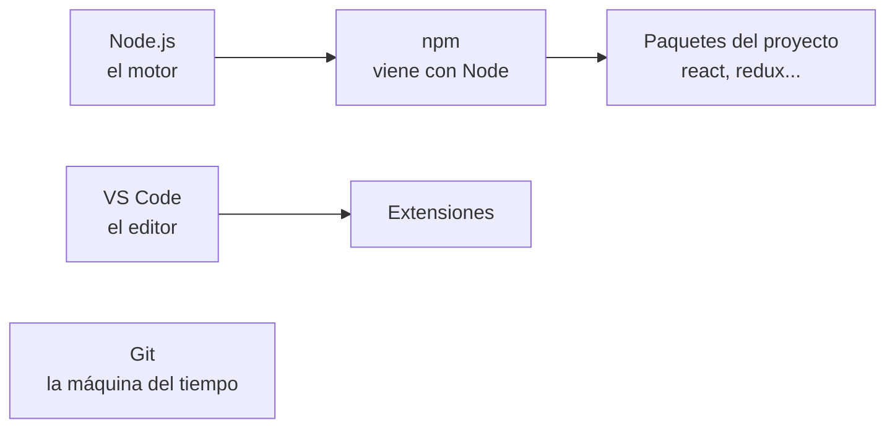

| Programa | Para qué sirve | Analogía | Cómo comprobar que está |
|---|---|---|---|
| **Node.js** (versión LTS, 20 o superior; este proyecto se probó con la 24) | Ejecuta JavaScript fuera del navegador. Vite y npm lo necesitan | El **motor** del coche | `node -v` |
| **npm** (viene con Node) | Descarga e instala librerías | La **tienda de repuestos** | `npm -v` |
| **VS Code** | Editor de código | Tu **taller** | Abrirlo |
| **Git** | Guarda versiones de tu código | Una **máquina del tiempo** para volver atrás si rompes algo | `git --version` |

**Extensiones de VS Code recomendadas:**

- **ESLint** → subraya en rojo los errores mientras escribes.
- **Markdown Preview Mermaid Support** → para ver los diagramas de esta guía.
- **Redux DevTools** (es una extensión del **navegador** Chrome/Firefox/Edge, no de VS Code) → te deja ver cada acción y el estado del store en tiempo real. **Muy recomendable.**

> ⚠️ **OBLIGATORIO:** instala Node desde [nodejs.org](https://nodejs.org) eligiendo la versión **LTS**. Después **cierra y vuelve a abrir** la terminal y VS Code; si no, no reconocerán el comando `node`.

---

## 5. Crear el proyecto paso a paso

> Si ya tienes este proyecto descargado, salta al paso 5.4.

### 5.1 Crear el esqueleto con Vite

```bash
npm create vite@latest redux -- --template react-ts
cd redux
npm install
```

- **Qué hace:** Vite crea una carpeta con un proyecto React + TypeScript listo para funcionar.
- **Por qué Vite:** arranca en milisegundos y recarga la página sola cuando guardas un archivo. Es como un horno microondas frente a uno de leña.
- **`npm install`:** lee `package.json` y descarga todas las librerías en la carpeta `node_modules`.

### 5.2 Instalar Redux y el Router

```bash
npm install @reduxjs/toolkit react-redux react-router
```

| Paquete | Qué aporta | Por qué lo necesitamos |
|---|---|---|
| `@reduxjs/toolkit` | `configureStore`, `createSlice` | Es la forma **oficial y moderna** de escribir Redux. Ahorra muchísimo código |
| `react-redux` | `Provider`, `useSelector`, `useDispatch` | Es el **puente** entre React y Redux. Redux solo no sabe nada de React |
| `react-router` | `createBrowserRouter`, `Link`, `Outlet` | Para tener varias "páginas" con URLs distintas (`/hermano`, `/hijo`) |

> ❌ **PROHIBIDO:** instalar el paquete antiguo `redux` a secas y escribir reducers con `switch`. Funciona, pero es la forma antigua y te obliga a escribir 3 veces más código. Usa **Redux Toolkit**.

### 5.3 (Opcional) React Compiler

Este proyecto lleva activado el **React Compiler** (`babel-plugin-react-compiler`). Es un "ayudante" que optimiza tus componentes automáticamente para que no se redibujen sin necesidad. **No tienes que hacer nada** para usarlo; ya viene configurado en `vite.config.ts`.

### 5.4 Arrancar el proyecto

```bash
npm install      # solo la primera vez, o si alguien añadió librerías
npm run dev      # arranca el servidor de desarrollo
```

Abre en el navegador la dirección que aparece (normalmente `http://localhost:5173`).

| Comando | Cuándo usarlo |
|---|---|
| `npm run dev` | Mientras programas. Recarga sola |
| `npm run build` | Para generar la versión final que se sube a internet (carpeta `dist/`). **Revisa los errores de TypeScript** |
| `npm run lint` | Para buscar errores y malas prácticas en el código |
| `npm run preview` | Para probar en local lo que generó `build` |

> 🔴 **Ojo, situación real de este proyecto:** ahora mismo `npm run dev` funciona, pero `npm run build` y `npm run lint` **fallan**. Lo arreglamos en el [Laboratorio, experimento 1](#experimento-1-el-build-falla-error-real-de-este-proyecto).

---

## 6. El mapa de carpetas

```
redux/
├── index.html                 ← La única página HTML. Tiene un <div id="root"> vacío
├── package.json               ← Lista de librerías y comandos (la "receta")
├── package-lock.json          ← Versiones exactas instaladas (NO se edita a mano)
├── vite.config.ts             ← Configuración de Vite (plugins)
├── tsconfig*.json             ← Reglas de TypeScript
├── eslint.config.js           ← Reglas del "corrector" de código
├── public/                    ← Archivos que se sirven tal cual (favicon)
├── node_modules/              ← Librerías descargadas (NO se toca, NO se sube a git)
└── src/                       ← ✨ TU CÓDIGO
    ├── main.tsx               ← Punto de entrada: monta React, Redux y el Router
    ├── App.tsx                ← El "marco": menú + hueco para la página
    ├── index.css / App.css    ← Estilos
    ├── assets/                ← Imágenes
    ├── components/
    │   ├── hermano.component.tsx   ← Página "Hermano"
    │   └── hijo.component.tsx      ← Página "Hijo"
    └── redux/
        ├── store.redux.ts          ← 🏦 La bóveda
        ├── counterSlice.redux.ts   ← 🗂️ El departamento "contador"
        └── hooks.redux.ts          ← 📺 Hooks con tipos (atajos seguros)
```

**¿Por qué los nombres terminan en `.redux.ts` y `.component.tsx`?** Es una **convención** de este proyecto (no obligatoria para React) para saber de un vistazo qué es cada archivo. Es como poner etiquetas de colores en las carpetas de un archivador.

**¿`.ts` o `.tsx`?**
- `.ts` → solo lógica TypeScript (sin HTML).
- `.tsx` → TypeScript **con JSX** (las etiquetas tipo HTML como `<h1>`). Si escribes `<h1>` en un `.ts`, da error.

### ¿En qué orden se conectan los archivos?

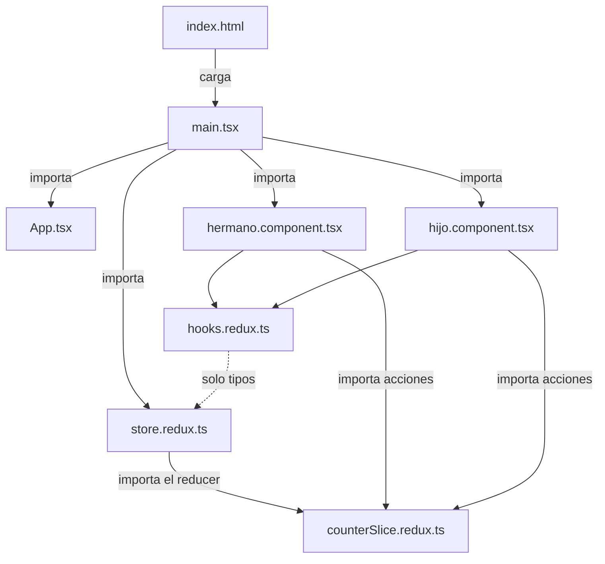

---

## 7. Recorrido línea por línea

Vamos en el **orden en que se ejecutan** las cosas, no en orden alfabético.

### 7.1 `index.html` — el escenario vacío

```html
<!doctype html>
<html lang="en">
  <head>
    <meta charset="UTF-8" />
    <link rel="icon" type="image/svg+xml" href="/favicon.svg" />
    <meta name="viewport" content="width=device-width, initial-scale=1.0" />
    <title>redux</title>
  </head>
  <body>
    <div id="root"></div>
    <script type="module" src="/src/main.tsx"></script>
  </body>
</html>
```

| Línea | Qué hace | Por qué |
|---|---|---|
| `<!doctype html>` | Dice al navegador "esto es HTML moderno" | Sin esto el navegador entra en un modo antiguo y raro |
| `<meta charset="UTF-8" />` | Permite tildes, ñ, emojis | Sin esto "contraseña" se vería "contraseña" |
| `<link rel="icon" ...>` | El iconito de la pestaña | Estética |
| `<meta name="viewport" ...>` | Hace que se vea bien en el móvil | Sin esto el móvil muestra la página diminuta |
| `<title>redux</title>` | Texto de la pestaña | Puedes cambiarlo |
| `<div id="root"></div>` | **Un hueco vacío** | Aquí React "pintará" toda la aplicación. Es el **lienzo en blanco** |
| `<script type="module" src="/src/main.tsx">` | Carga tu código | `type="module"` permite usar `import`/`export` |

> **Analogía:** `index.html` es un **teatro vacío** con un escenario (`#root`). `main.tsx` es el director que trae a los actores.

---

### 7.2 `src/main.tsx` — el director de orquesta

```tsx
import { StrictMode } from "react";
import { createRoot } from "react-dom/client";
import "./index.css";
import App from "./App.tsx";
import { createBrowserRouter, RouterProvider } from "react-router";
import { Hermano } from "./components/hermano.component.tsx";
import { Hijo } from "./components/hijo.component.tsx";
import { Provider } from "react-redux";
import { store } from "./redux/store.redux.ts";
```

| Import | Qué trae | Para qué |
|---|---|---|
| `StrictMode` | Un "modo inspector" de React | En desarrollo ejecuta algunas cosas **dos veces** para cazar errores. En producción no hace nada |
| `createRoot` | La función que conecta React con el `<div id="root">` | Sin esto, React no tiene dónde pintar |
| `"./index.css"` | Estilos globales | Al importar un CSS, Vite lo aplica a la página |
| `App` | El componente marco (menú) | `import App` **sin llaves** porque se exportó con `export default` |
| `createBrowserRouter, RouterProvider` | El ascensor y su motor | Para las rutas `/hermano` y `/hijo` |
| `{ Hermano }`, `{ Hijo }` | Las páginas | **Con llaves** porque se exportaron con `export function` (export *con nombre*) |
| `Provider` | El cable que conecta la bóveda | Para que todos los componentes puedan usar el store |
| `store` | La bóveda | Creada en `store.redux.ts` |

> 📌 **Llaves o no llaves:** `export default X` → `import X from`. `export function X` / `export const X` → `import { X } from`. Si te equivocas, te dará `undefined` o un error. Ver [experimento 7](#experimento-7-llaves-equivocadas-en-un-import).

```tsx
const ruta = createBrowserRouter([
  {
    path: "/",
    Component: App,
    children: [
      { path: "/hermano", Component: Hermano },
      { path: "/hijo",    Component: Hijo },
    ],
  },
]);
```

- **`createBrowserRouter([...])`**: crea el "mapa del edificio". Cada objeto es un piso.
- **`path: "/"`**: la dirección raíz (`http://localhost:5173/`).
- **`Component: App`**: en la raíz se muestra `App`. Ojo: es `Component` con **C mayúscula** y se pasa la función `App`, **no** `<App />`.
- **`children`**: rutas **anidadas**. Significa: "cuando estés en `/hermano`, muestra `App` **y dentro de App**, en su `<Outlet />`, muestra `Hermano`".

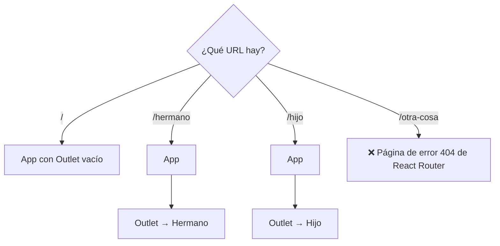

> **¿Por qué rutas anidadas?** Para que el **menú (App) no se repita** en cada página. App es el marco del cuadro; Hermano/Hijo son la foto que cambias.

```tsx
createRoot(document.getElementById("root")!).render(
  <StrictMode>
    <Provider store={store}>
      <RouterProvider router={ruta} />
    </Provider>
  </StrictMode>,
);
```

| Parte | Qué hace | Por qué |
|---|---|---|
| `document.getElementById("root")` | Busca el `<div id="root">` del HTML | Es el lienzo |
| `!` (signo de exclamación final) | Le dice a TypeScript "confía en mí, este elemento **existe**" | `getElementById` podría devolver `null`; sin `!` TypeScript se queja |
| `.render(...)` | Pinta lo que le pases | Arranque de la app |
| `<StrictMode>` | Envuelve todo en modo inspector | Detecta errores pronto |
| `<Provider store={store}>` | **Conecta la bóveda** a todo lo que está dentro | Sin esto, `useAppSelector` explota |
| `<RouterProvider router={ruta} />` | Arranca el ascensor con el mapa `ruta` | Muestra la página según la URL |

**Por qué este orden de "cajas" (muñecas rusas):**

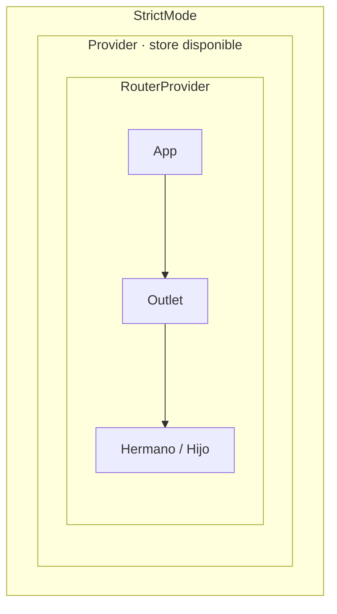

El `Provider` va **por fuera** del Router para que **todas** las páginas, sin excepción, tengan acceso al store. Es como instalar el wifi en el **edificio entero** en lugar de en un solo piso.

---

### 7.3 `src/redux/counterSlice.redux.ts` — el departamento "contador"

Este es **el corazón de Redux** en el proyecto. Aquí se define *qué dato hay* y *cómo puede cambiar*.

```ts
import { createSlice } from '@reduxjs/toolkit'
```
Trae la herramienta que fabrica un slice (un "trozo" del estado con sus reglas).

```ts
export interface CounterState{
    valor:number
}
```
- **`interface`**: un **molde** de TypeScript. Dice "el estado del contador es un objeto con una propiedad `valor` que es un número".
- **Por qué:** si mañana alguien escribe `state.valor = "hola"`, TypeScript lo marcará en rojo **antes** de ejecutar nada.
- **`export`**: para poder usar este molde en otros archivos.

```ts
const initialState: CounterState = {
  valor: 0
}
```
- El **saldo de apertura**: el contador empieza en 0.
- `: CounterState` obliga a que este objeto cumpla el molde.

```ts
export const counterSlice = createSlice({
    name:'contador',
    initialState,
    reducers:{
        incrementar: state=>{
            state.valor+=1;
        },
        decrementar: state=>{
            state.valor-=1;
        },
        reiniciar: state=>{
            state.valor=0
        }
    }
})
```

| Parte | Qué hace | Por qué |
|---|---|---|
| `name: 'contador'` | Nombre del departamento | Se usa para fabricar el "tipo" de cada acción: `"contador/incrementar"`. Así en Redux DevTools ves claramente de dónde viene cada acción |
| `initialState` | Saldo inicial | Es abreviatura de `initialState: initialState` |
| `reducers: { ... }` | El **manual del cajero**: lista de operaciones permitidas | Solo estas tres cosas pueden pasarle al contador. Nada más |
| `incrementar: state => { state.valor += 1 }` | Suma 1 | — |
| `decrementar: state => { state.valor -= 1 }` | Resta 1 | — |
| `reiniciar: state => { state.valor = 0 }` | Vuelve a 0 | — |

> 🧙 **El truco de magia (Immer):** en Redux "clásico" **está prohibido modificar el estado directamente**; había que crear un objeto nuevo (`return { ...state, valor: state.valor + 1 }`). Redux Toolkit incluye una librería llamada **Immer** que te deja *escribir como si modificaras* (`state.valor += 1`), pero por debajo **crea una copia nueva**.
>
> **Analogía:** es como escribir sobre un **papel de calco** encima del original. Tú garabateas tranquilamente; al terminar, Immer pasa tus cambios a una hoja nueva limpia y el original queda intacto.
>
> ⚠️ **Esta magia SOLO funciona dentro de los `reducers` de `createSlice`**. Fuera de ahí, modificar el estado está prohibido.

```ts
export const { incrementar, decrementar, reiniciar } = counterSlice.actions
```
- `createSlice` fabrica **automáticamente** una función "creadora de formularios" por cada reducer.
- `incrementar()` devuelve el objeto `{ type: "contador/incrementar" }`. Eso es una **action**.
- Las sacamos con **desestructuración** (`const { a, b } = objeto`) y las exportamos para que los componentes las usen.

```ts
export default counterSlice.reducer
```
- `counterSlice.reducer` es **el cajero completo**: una sola función que sabe atender los tres tipos de formulario.
- Se exporta **por defecto** porque es lo que el store necesita.

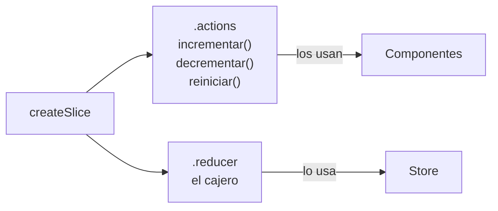

**¿Por qué todo junto en un slice?** Antes de Redux Toolkit, las acciones, sus tipos y el reducer iban en 3 archivos distintos y había que mantenerlos sincronizados a mano. El slice los **genera juntos**, así es imposible que se desincronicen.

---

### 7.4 `src/redux/store.redux.ts` — la bóveda

```ts
import { configureStore } from '@reduxjs/toolkit'
import counterReducer from './counterSlice.redux'
```
- `configureStore`: fabrica la bóveda con buenas opciones de fábrica (conexión a Redux DevTools y avisos si haces algo prohibido, como mutar el estado).
- `counterReducer`: es el `export default` del slice. **Lo puedes llamar como quieras al importarlo** porque es default; aquí se llama `counterReducer`.

```ts
export const store = configureStore({
  reducer: {
    contador: counterReducer
  }
})
```
- `reducer: { contador: counterReducer }`: la bóveda tiene **un cajón llamado `contador`**, gestionado por `counterReducer`.
- Por eso el estado completo tiene esta forma:

```ts
{
  contador: { valor: 0 }
}
```

y por eso en los componentes se lee `state.contador.valor`.

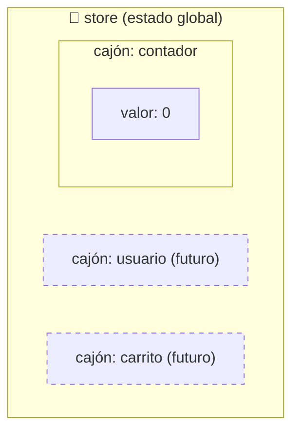

> **Por qué un objeto con claves y no directamente el reducer:** porque mañana añadirás más slices (`usuario`, `carrito`...). Cada uno será un cajón. **La clave que pongas aquí (`contador`) es la que usarás en `state.XXXX`.** Si cambias una, tienes que cambiar la otra. Ver [experimento 3](#experimento-3-cambiar-el-nombre-del-cajón).

```ts
export type RootState = ReturnType<typeof store.getState>
export type AppDispatch = typeof store.dispatch
export type AppStore = typeof store
```

Esto es **solo TypeScript** (desaparece al ejecutar). Sirve para que el editor sepa exactamente qué hay en la bóveda.

| Tipo | Traducción a lenguaje humano | Para qué |
|---|---|---|
| `RootState` | "La forma exacta de todo el estado: `{ contador: { valor: number } }`" | Para que al escribir `state.` el editor te sugiera `contador` |
| `AppDispatch` | "El tipo exacto de la ventanilla de esta bóveda" | Necesario cuando uses acciones asíncronas (thunks) |
| `AppStore` | "El tipo del store completo" | Útil en tests. Ahora mismo no se usa |

> **Por qué se calculan (`ReturnType<typeof ...>`) en vez de escribirse a mano:** si añades un slice nuevo, estos tipos **se actualizan solos**. Escribirlos a mano sería como mantener un inventario en papel en lugar de que lo cuente la máquina.

---

### 7.5 `src/redux/hooks.redux.ts` — atajos con tipos

```ts
import { useDispatch, useSelector } from 'react-redux'
import type { AppDispatch, RootState } from './store.redux'

export const useAppDispatch = useDispatch.withTypes<AppDispatch>()
export const useAppSelector = useSelector.withTypes<RootState>()
```

| Línea | Qué hace | Por qué |
|---|---|---|
| `import { useDispatch, useSelector }` | Los hooks originales de react-redux | No saben nada de tu store concreto |
| `import type { ... }` | Importa **solo tipos** | La palabra `type` es **obligatoria** en este proyecto por la regla `verbatimModuleSyntax` del tsconfig. Además evita un import circular en tiempo de ejecución |
| `useDispatch.withTypes<AppDispatch>()` | Crea una versión de `useDispatch` que **ya conoce** tu store | No tendrás que escribir el tipo cada vez |
| `useSelector.withTypes<RootState>()` | Crea una versión de `useSelector` que **ya conoce** la forma del estado | Al escribir `state.` el editor autocompleta `contador.valor` |

> **Analogía:** `useSelector` es una **llave maestra genérica** que abre cualquier caja pero no sabe qué hay dentro. `useAppSelector` es una **llave hecha a medida** para *tu* bóveda, con una etiqueta que dice qué hay en cada cajón.

> ✅ **OBLIGATORIO (buena práctica):** en los componentes usa **siempre** `useAppSelector` y `useAppDispatch`, nunca los originales.

---

### 7.6 `src/App.tsx` — el marco con el menú

```tsx
import { useState } from 'react'
import heroImg from './assets/hero.png'
import reactLogo from './assets/react.svg'
import viteLogo from './assets/vite.svg'
import './App.css'
import { Link, Outlet } from 'react-router'
```

> 🔴 **Las 4 primeras importaciones sobran.** `useState`, `heroImg`, `reactLogo` y `viteLogo` son restos de la plantilla de Vite y **no se usan**. Por eso `npm run build` falla. Ver [experimento 1](#experimento-1-el-build-falla-error-real-de-este-proyecto).

```tsx
function App() {
  const [count, setCount] = useState(0)
```
- Otro resto de la plantilla: un contador **local** que nadie usa. Interesante para comparar: **este** contador es privado de `App`; el de Redux es compartido.

```tsx
  return (
    <>
      <main>
        <Link to="/">Inicio</Link><br />
        <Link to="/hermano">Hermano</Link><br />
        <Link to="/hijo">Hijo</Link>

        <Outlet></Outlet>
      </main>
    </>
  )
}

export default App
```

| Parte | Qué hace | Por qué |
|---|---|---|
| `<> ... </>` | **Fragmento**: un envoltorio invisible | Un componente debe devolver **un solo elemento raíz**. El fragmento cumple la regla sin añadir un `<div>` extra |
| `<Link to="/hermano">` | Un enlace que cambia la URL **sin recargar la página** | Si usaras `<a href>`, el navegador recargaría todo y **perderías el estado de Redux** (ver [experimento 9](#experimento-9-usar-a-href-en-lugar-de-link)) |
| `<br />` | Salto de línea | En JSX las etiquetas vacías **deben cerrarse** con `/>` |
| `<Outlet />` | El **hueco** donde React Router mete la página hija | Sin él, Hermano e Hijo nunca aparecen |
| `export default App` | Exportación por defecto | Por eso en `main.tsx` se importa sin llaves |

---

### 7.7 `src/components/hermano.component.tsx` — un cliente del banco

```tsx
import { useAppDispatch, useAppSelector } from "../redux/hooks.redux";
import { incrementar, decrementar, reiniciar } from "../redux/counterSlice.redux";
```
- `../` significa "sube una carpeta" (de `components/` a `src/`) y luego entra en `redux/`.
- Se importan los hooks con tipos y los "creadores de formularios".

```tsx
export function Hermano() {
```
- Un **componente** es una función cuyo nombre **empieza con mayúscula** y que devuelve JSX.
- **Por qué mayúscula:** React distingue `<hermano>` (etiqueta HTML desconocida) de `<Hermano>` (tu componente) por la primera letra.

```tsx
  const count = useAppSelector((state) => state.contador.valor);
```
- **Selector:** "de toda la bóveda, dame solo `contador.valor`".
- **Suscripción automática:** cada vez que ese valor cambie, React **vuelve a dibujar** este componente con el número nuevo.
- **Por qué pedir solo `valor` y no todo el `state`:** el componente solo se redibuja si cambia **lo que pidió**. Si pidieras todo, se redibujaría con cualquier cambio de cualquier cajón.

```tsx
  const dispatch = useAppDispatch();
```
- Te da la **ventanilla** para entregar formularios.

```tsx
  return (
    <>
      <h1>Hermano</h1>
      <h2>contador Hermano: {count}</h2>
```
- `{count}`: las **llaves** en JSX significan "aquí va JavaScript". Muestra el número.

```tsx
      <button onClick={() => { dispatch(incrementar()); }}>
        Incrementar +1
      </button>
```

Desmontemos esta línea, que es la más importante:

| Trozo | Significado |
|---|---|
| `onClick={...}` | "Cuando hagan clic, ejecuta esta función" |
| `() => { ... }` | Una función flecha. **Se crea ahora pero se ejecuta después**, al hacer clic |
| `incrementar()` | Rellena el formulario → `{ type: "contador/incrementar" }` |
| `dispatch(...)` | Entrega el formulario en ventanilla |

> ⚠️ **¿Por qué `() => dispatch(...)` y no `onClick={dispatch(incrementar())}`?** Porque la segunda forma **ejecuta el dispatch al dibujar**, no al hacer clic. Ver [experimento 5](#experimento-5-ejecutar-el-dispatch-sin-función-flecha).

Los otros dos botones son idénticos con `decrementar()` y `reiniciar()`.

---

### 7.8 `src/components/hijo.component.tsx` — otro cliente

Es **exactamente igual** que Hermano, solo cambian los textos y el formato (todo en una línea). Existe para **demostrar** que dos componentes separados leen y modifican **el mismo dato**.

```tsx
const count = useAppSelector((state) => state.contador.valor);
const dispatch = useAppDispatch()
// ...
<button onClick={()=>{dispatch(incrementar())}}>Incrementar +1</button>
```

> 💡 **Mejora posible:** Hermano e Hijo son casi idénticos. En un proyecto real crearías un componente `<BotonesContador />` y lo reutilizarías en los dos. Ver [ejercicio 4](#13-ejercicios-para-practicar).

---

### 7.9 Archivos de configuración (no los tocarás a menudo)

#### `package.json` — la receta

```json
"type": "module",
```
Permite usar `import`/`export` en archivos de configuración.

```json
"scripts": {
  "dev": "vite",
  "build": "tsc -b && vite build",
  "lint": "eslint .",
  "preview": "vite preview"
}
```
- `npm run dev` ejecuta `vite`.
- `npm run build` ejecuta **primero** `tsc -b` (revisión de tipos) **y solo si pasa** (`&&`) ejecuta `vite build`. Por eso un error de tipos **bloquea** el build, aunque `dev` funcione.

```json
"dependencies":    { ... }   ← lo que la app necesita para funcionar (react, redux...)
"devDependencies": { ... }   ← herramientas solo para programar (typescript, eslint, vite...)
```
Los símbolos `^2.15.0` significan "esta versión o una más nueva compatible (2.x)".

#### `vite.config.ts`

```ts
import react, { reactCompilerPreset } from '@vitejs/plugin-react'
import babel from '@rolldown/plugin-babel'
import { defineConfig } from 'vite'

export default defineConfig({
  plugins: [
    react(),                                   // Entiende JSX y recarga en caliente
    babel({ presets: [reactCompilerPreset()] }) // Activa el React Compiler
  ],
})
```

#### `tsconfig.app.json` — las reglas de TypeScript para `src/`

Las opciones que más te afectarán:

| Opción | Qué provoca | Ejemplo |
|---|---|---|
| `"jsx": "react-jsx"` | Permite JSX sin importar React en cada archivo | — |
| `"noUnusedLocals": true` | **Error** si declaras algo y no lo usas | El fallo actual de `App.tsx` |
| `"noUnusedParameters": true` | Error si una función recibe un parámetro que no usa | `(a, b) => a` → error por `b` |
| `"verbatimModuleSyntax": true` | **Obliga** a escribir `import type` para tipos | `hooks.redux.ts` |
| `"allowImportingTsExtensions": true` | Permite `import App from "./App.tsx"` con extensión | `main.tsx` |
| `"noEmit": true` | TypeScript solo revisa, no genera archivos (eso lo hace Vite) | — |

`tsconfig.json` solo "agrupa" a `tsconfig.app.json` (para tu código) y `tsconfig.node.json` (para `vite.config.ts`).

#### `eslint.config.js` — el corrector ortográfico del código

Activa reglas recomendadas de JavaScript, TypeScript y, muy importante, **`react-hooks`**, que vigila las [reglas de los hooks](#10-acciones-prohibidas).

#### `.gitignore`

Lista de cosas que **git no debe guardar**: `node_modules` (pesa cientos de MB y se regenera con `npm install`), `dist` (se regenera con `build`), logs...

---

## 8. El viaje completo de un clic

¿Qué pasa exactamente cuando pulsas **"Incrementar +1"** en la página Hermano?

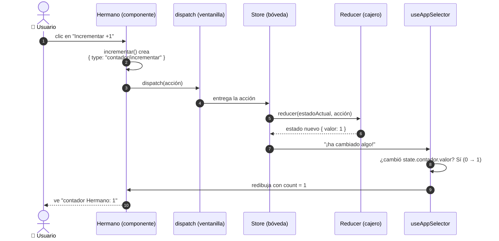

Y si después vas a la página Hijo:

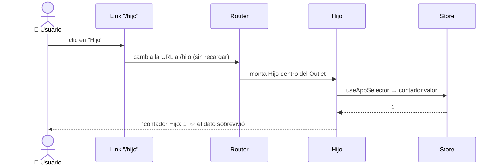

**El flujo es siempre en un solo sentido (unidireccional).** Es como un río: el agua no sube.

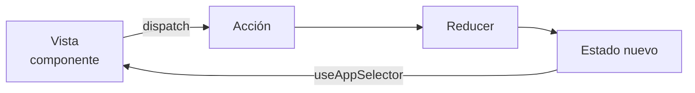

> **Por qué un solo sentido:** si cualquiera pudiera cambiar el estado desde cualquier sitio, cuando algo falle no sabrías **quién** fue. Con un único camino, Redux DevTools te muestra la lista exacta de acciones, en orden, y puedes "rebobinar".

---

## 9. Acciones OBLIGATORIAS

| ✅ Obligatorio | Por qué | Qué pasa si no |
|---|---|---|
| Tener **Node.js** instalado | Vite y npm funcionan con Node | `'npm' no se reconoce como comando` |
| Ejecutar **`npm install`** tras clonar el proyecto o cuando cambie `package.json` | Descarga las librerías a `node_modules` | `Failed to resolve import "react-redux"` |
| Envolver la app en **`<Provider store={store}>`** | Conecta la bóveda | `could not find react-redux context value` ([exp. 2](#experimento-2-quitar-el-provider)) |
| **Registrar cada slice** en `configureStore({ reducer: { ... } })` | Un slice que no está en el store no existe para nadie | `state.loQueSea` es `undefined` ([exp. 3](#experimento-3-cambiar-el-nombre-del-cajón)) |
| Usar la **misma clave** en el store y en el selector | `contador` en el store ↔ `state.contador` en el componente | `Cannot read properties of undefined` |
| **Llamar** a la acción con paréntesis: `incrementar()` | El dispatch necesita el *objeto* acción, no la *función* | Error o acción ignorada ([exp. 4](#experimento-4-olvidar-los-paréntesis-de-la-acción)) |
| Exportar las acciones (`counterSlice.actions`) y el reducer (`counterSlice.reducer`) | Los componentes necesitan las acciones; el store, el reducer | `has no exported member` |
| Nombres de componentes en **Mayúscula** | React los distingue así de las etiquetas HTML | El componente no se muestra |
| Poner **`<Outlet />`** en el componente padre de rutas anidadas | Es el hueco de las páginas hijas | Las páginas no aparecen ([exp. 8](#experimento-8-quitar-el-outlet)) |
| Usar **`<Link>`** para navegar dentro de la app | No recarga la página | Se pierde el estado ([exp. 9](#experimento-9-usar-a-href-en-lugar-de-link)) |
| Usar **`import type`** para importar tipos | Regla `verbatimModuleSyntax` del proyecto | Error TS1484 ([exp. 6](#experimento-6-quitar-import-type)) |
| Llamar a los hooks (`useAppSelector`, `useAppDispatch`, `useState`) **en el nivel superior** del componente | Regla de los hooks de React | Error de React / ESLint ([exp. 10](#experimento-10-hook-dentro-de-un-if)) |
| Pasar `npm run build` y `npm run lint` **sin errores** antes de entregar | Es lo que se sube a producción | El despliegue falla |

---

## 10. Acciones PROHIBIDAS

| ❌ Prohibido | Por qué | Haz esto en su lugar |
|---|---|---|
| **Modificar el estado fuera de un reducer** (`store.getState().contador.valor = 5`) | Nadie se entera del cambio: la pantalla no se actualiza y Redux DevTools no lo registra. Es meter la mano en la bóveda | `dispatch(unaAccion())` |
| **Mutar Y devolver** a la vez en un reducer (`state.valor++; return { valor: 99 }`) | Immer no sabe cuál de los dos usar y lanza error | O mutas (`state.valor++`) **o** devuelves un objeto nuevo. Nunca ambos |
| **Reasignar** `state` completo (`state = { valor: 0 }`) | Solo cambias la variable local, no el estado real. **No hace nada** | `state.valor = 0` o `return { valor: 0 }` |
| Poner en un reducer cosas **impredecibles**: `fetch`, `Math.random()`, `Date.now()`, `console.log` en exceso, `localStorage` | Un reducer debe ser **puro**: misma entrada → misma salida, siempre. Como una calculadora: 2+2 siempre da 4 | Haz esas cosas fuera (en el componente o en un *thunk*) y pasa el resultado como `payload` |
| Guardar en el store cosas **no serializables**: funciones, `Date`, `Map`, `Promise`, elementos del DOM | Redux debe poder convertir el estado a texto (JSON) para DevTools y depuración | Guarda datos simples: números, textos, booleanos, arrays, objetos |
| **Llamar hooks dentro de `if`, bucles o funciones internas** | React identifica los hooks por su **orden**; si cambia, se lía | Llámalos siempre arriba del componente |
| `onClick={dispatch(incrementar())}` (sin `() =>`) | Se ejecuta al dibujar, no al hacer clic → bucle infinito | `onClick={() => dispatch(incrementar())}` |
| **Editar `node_modules`** o `package-lock.json` a mano | Se sobrescriben en el próximo `npm install` | Usa `npm install paquete` / `npm uninstall paquete` |
| **Subir `node_modules`** a git | Pesa muchísimo y se regenera solo | Ya está en `.gitignore`; no lo quites |
| Usar `useSelector` / `useDispatch` sin tipos en los componentes | Pierdes el autocompletado y la detección de errores | `useAppSelector` / `useAppDispatch` |
| Meter **todo** en Redux (lo que escribe el usuario en un input, si un menú está abierto...) | Añade complejidad sin beneficio | Estado **local** con `useState` (ver [sección 12](#12-cuándo-necesito-cada-cosa)) |
| Escribir `echo "texto" >> README.md` desde PowerShell antiguo | Guarda el texto en otra codificación (UTF-16) y aparece como `#   r e d u x ...` con espacios raros. **Le pasó a este README** (última línea) | Edita el archivo en VS Code |

---

## 11. Laboratorio: rómpelo y arréglalo

> 🧪 **Antes de empezar:** guarda el estado actual con git para poder volver atrás siempre:
> ```bash
> git add .
> git commit -m "Antes del laboratorio"
> ```
> Si algo queda roto y no sabes arreglarlo: `git restore .` deshace **todos** los cambios no guardados en commit. (⚠️ Borra tus cambios sin preguntar; úsalo solo cuando quieras volver de verdad.)

**Método para cada experimento:**

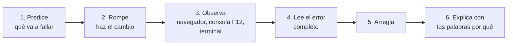

> 🔍 **Dónde mirar los errores:**
> - **Pantalla en blanco** → abre la consola del navegador con **F12 → pestaña Console**.
> - **Errores de tipos** → subrayado rojo en VS Code o `npx tsc -b` en la terminal.
> - **Errores de reglas** → `npm run lint`.

---

### Experimento 1: el build falla (error REAL de este proyecto)

**Este no hace falta romperlo: ya está roto.**

**Observa:**
```bash
npm run build
```
Resultado:
```
src/App.tsx(2,1): error TS6133: 'heroImg' is declared but its value is never read.
src/App.tsx(3,1): error TS6133: 'reactLogo' is declared but its value is never read.
src/App.tsx(4,1): error TS6133: 'viteLogo' is declared but its value is never read.
src/App.tsx(9,10): error TS6133: 'count' is declared but its value is never read.
src/App.tsx(9,17): error TS6133: 'setCount' is declared but its value is never read.
```

**Por qué:** `tsconfig.app.json` tiene `"noUnusedLocals": true`. Son restos de la plantilla de Vite. `npm run dev` **no** revisa los tipos, por eso parece que todo va bien.

> **Analogía:** es como llevar en la mochila herramientas que no usas. Funciona, pero el inspector (TypeScript) no te deja pasar el control con peso inútil.

**Arreglo:** deja `App.tsx` así:
```tsx
import './App.css'
import { Link, Outlet } from 'react-router'

function App() {
  return (
    <>
      <main>
        <Link to="/">Inicio</Link><br />
        <Link to="/hermano">Hermano</Link><br />
        <Link to="/hijo">Hijo</Link>

        <Outlet />
      </main>
    </>
  )
}

export default App
```
Vuelve a ejecutar `npm run build` y `npm run lint`: ya no hay errores.

**Lección:** `dev` funcionando **no** significa que el proyecto esté bien. Ejecuta siempre `build` y `lint` antes de entregar.

---

### Experimento 2: quitar el Provider

**Rompe** — en `main.tsx`:
```tsx
createRoot(document.getElementById("root")!).render(
  <StrictMode>
    <RouterProvider router={ruta} />
  </StrictMode>,
);
```
**Predice:** ¿se verá el menú? ¿Y la página Hermano?

**Observa:** el menú en `/` se ve, pero al ir a `/hermano` aparece un error parecido a:
```
could not find react-redux context value; please ensure the component is wrapped in a <Provider>
```
**Por qué:** `App` no usa Redux, así que funciona. `Hermano` llama a `useAppSelector`, que busca la bóveda... y no hay cable conectado.

**Arreglo:** vuelve a poner `<Provider store={store}> ... </Provider>` alrededor del `RouterProvider`.

---

### Experimento 3: cambiar el nombre del cajón

**Rompe** — en `store.redux.ts`:
```ts
reducer: {
  contadorcito: counterReducer
}
```
**Observa:**
- VS Code marca en rojo `state.contador` en Hermano e Hijo: *"Property 'contador' does not exist on type..."*. ← **Gracias a los tipos**, te enteras antes de ejecutar.
- En el navegador: `Cannot read properties of undefined (reading 'valor')`.

**Por qué:** la bóveda ahora tiene un cajón `contadorcito`; `state.contador` no existe → es `undefined` → `undefined.valor` explota.

**Arreglo:** usa la misma palabra en los dos sitios. O vuelves a `contador`, o cambias los selectores a `state.contadorcito.valor`.

**Lección:** la clave del store y el selector **van juntas**.

---

### Experimento 4: olvidar los paréntesis de la acción

**Rompe** — en Hijo:
```tsx
<button onClick={()=>{dispatch(incrementar)}}>Incrementar +1</button>
```
**Observa:** TypeScript lo marca en rojo. Si lo ejecutas, al hacer clic no suma (o salta un error de Redux sobre acciones que deben ser objetos simples).

**Por qué:** `incrementar` es la **fábrica** de formularios; `incrementar()` es el **formulario**. Entregaste la fábrica en ventanilla.

**Arreglo:** `dispatch(incrementar())`.

---

### Experimento 5: ejecutar el dispatch sin función flecha

**Rompe** — en Hijo:
```tsx
<button onClick={dispatch(incrementar())}>Incrementar +1</button>
```
**Predice:** ¿qué pasará al entrar en `/hijo`?

**Observa:** el número **sube solo** sin tocar nada, y React avisa de un error (tipos incorrectos en `onClick`, e incluso *"Too many re-renders"* / bucle de actualizaciones).

**Por qué:**
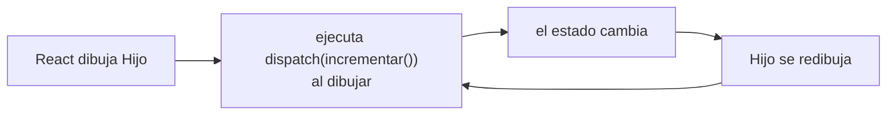
Sin `() =>`, el código se ejecuta **al dibujar** en vez de **al hacer clic**. Es como un timbre que suena solo cada vez que miras la puerta.

**Arreglo:** `onClick={() => dispatch(incrementar())}`.

---

### Experimento 6: quitar `import type`

**Rompe** — en `hooks.redux.ts`:
```ts
import { AppDispatch, RootState } from './store.redux'
```
**Observa:** error TS1484: *"'AppDispatch' is a type and must be imported using a type-only import when 'verbatimModuleSyntax' is enabled."*

**Por qué:** los tipos **desaparecen** al ejecutar. La regla obliga a marcarlos para que la herramienta sepa que puede borrar ese import sin miedo.

**Arreglo:** vuelve a poner `import type`.

---

### Experimento 7: llaves equivocadas en un import

**Rompe** — en `main.tsx`:
```tsx
import { App } from "./App.tsx";     // con llaves
import Hermano from "./components/hermano.component.tsx"; // sin llaves
```
**Observa:** *"Module has no exported member 'App'"* / *"has no default export"*.

**Por qué:**

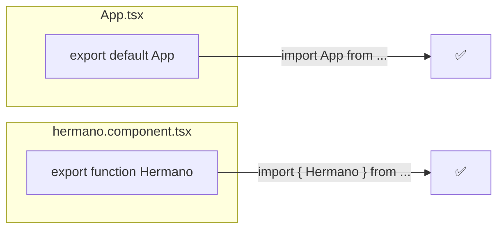
- `export default` es como **el regalo principal** de la caja: lo coges sin decir su nombre.
- `export` con nombre es como **un objeto etiquetado** dentro de la caja: tienes que pedirlo por su etiqueta exacta, entre llaves.

**Arreglo:** `import App from` y `import { Hermano } from`.

---

### Experimento 8: quitar el Outlet

**Rompe** — en `App.tsx`, borra `<Outlet />`.

**Observa:** los enlaces cambian la URL, pero **nunca** aparecen Hermano ni Hijo. Sin errores en consola. ← Los fallos silenciosos son los más traicioneros.

**Por qué:** React Router sabe *qué* mostrar, pero no tiene *dónde*. Es un ascensor sin puerta.

**Arreglo:** vuelve a poner `<Outlet />` donde quieras que aparezca la página.

---

### Experimento 9: usar `<a href>` en lugar de `<Link>`

**Rompe** — en `App.tsx`:
```tsx
<a href="/hermano">Hermano</a><br />
<a href="/hijo">Hijo</a>
```
**Prueba:** ve a Hermano, suma hasta 5, haz clic en Hijo.

**Observa:** Hijo muestra **0**. 😱 Y la página parpadea (recarga completa).

**Por qué:** el store de Redux vive en la **memoria** del navegador. `<a href>` recarga la página → se borra la memoria → la bóveda arranca de nuevo con `initialState`. `<Link>` cambia la URL **sin recargar**.

> Lo mismo pasa si pulsas **F5**: el contador vuelve a 0. **No es un fallo**, es cómo funciona Redux. Para que sobreviva a recargas habría que guardarlo en `localStorage` (tema avanzado: *redux-persist*).

**Arreglo:** vuelve a `<Link to="...">`.

---

### Experimento 10: hook dentro de un `if`

**Rompe** — en Hermano:
```tsx
export function Hermano() {
  const dispatch = useAppDispatch();
  let count = 0;
  if (Math.random() > 0.5) {
    count = useAppSelector((state) => state.contador.valor);
  }
  // ...
```
**Observa:** `npm run lint` da error: *"React Hook 'useAppSelector' is called conditionally"*. En el navegador puede fallar de forma aleatoria.

**Por qué:** React recuerda los hooks **por su posición**, como una lista de la compra numerada. Si un día el elemento 2 no está, todos los siguientes se desplazan y React confunde unos con otros.

**Arreglo:** llama al hook siempre, arriba del todo, y usa el `if` **después** con el valor ya obtenido.

---

### Experimento 11: reasignar `state` en el reducer

**Rompe** — en `counterSlice.redux.ts`:
```ts
reiniciar: state => {
  state = { valor: 0 }
}
```
**Observa:** el botón *reiniciar* **no hace nada**. ESLint puede avisar de que asignas a un parámetro.

**Por qué:** `state` es una **etiqueta** que apunta al borrador. Con `state = ...` pegas la etiqueta en otro objeto, pero el borrador sigue igual. Es como cambiar el nombre del buzón en lugar de meter la carta.

**Arreglo** (cualquiera de las dos):
```ts
reiniciar: state => { state.valor = 0 }       // mutar el borrador (Immer)
reiniciar: () => initialState                  // devolver un estado nuevo
```

---

### Experimento 12: mutar Y devolver

**Rompe:**
```ts
incrementar: state => {
  state.valor += 1
  return { valor: 100 }
}
```
**Observa:** al hacer clic, error de Immer: *"An immer producer returned a new value *and* modified its draft. Either return a new value *or* modify the draft."*

**Por qué:** le das dos respuestas contradictorias al cajero.

**Arreglo:** elige una: o `state.valor += 1`, o `return { valor: state.valor + 1 }`.

---

### Experimento 13: modificar el estado desde fuera

**Rompe** — en Hermano, pide el cajón entero y añade un botón "tramposo":
```tsx
const cajon = useAppSelector((state) => state.contador);
// ...
<button onClick={() => { cajon.valor = 99; }}>hack</button>
```
**Observa:** al hacer clic, error en la consola: *"Cannot assign to read only property 'valor' of object"*. Redux Toolkit **congela** (freeze) el estado para que nadie lo toque a escondidas. Y aunque lo lograras, la pantalla **no se actualizaría**.

**Por qué:** solo los cambios que pasan por `dispatch` avisan a los selectores.

**Arreglo:** crea una acción y despáchala.

---

### Experimento 14: olvidar `npm install`

**Rompe:** borra la carpeta `node_modules` y ejecuta `npm run dev`.

**Observa:** `'vite' no se reconoce como un comando interno o externo`.

**Arreglo:** `npm install`.

**Lección:** `node_modules` se puede borrar y regenerar cuando quieras. Es la solución nº 1 cuando "algo raro" pasa con las librerías.

---

### Tabla resumen de errores frecuentes

| Mensaje de error | Causa probable | Experimento |
|---|---|---|
| `is declared but its value is never read` | Import o variable sin usar | 1 |
| `could not find react-redux context value` | Falta `<Provider>` | 2 |
| `Cannot read properties of undefined (reading 'valor')` | Clave del store ≠ selector | 3 |
| `Actions must be plain objects` | `dispatch(incrementar)` sin `()` | 4 |
| `Too many re-renders` | `onClick={dispatch(...)}` sin `() =>` | 5 |
| `must be imported using a type-only import` | Falta `import type` | 6 |
| `has no exported member` / `no default export` | Llaves equivocadas en el import | 7 |
| La página hija no aparece, sin errores | Falta `<Outlet />` | 8 |
| El contador vuelve a 0 al navegar | `<a href>` en vez de `<Link>`, o F5 | 9 |
| `React Hook ... is called conditionally` | Hook dentro de `if` | 10 |
| El botón no hace nada | `state = ...` en el reducer | 11 |
| `returned a new value *and* modified its draft` | Mutar y devolver a la vez | 12 |
| `Cannot assign to read only property` | Modificar el estado fuera del reducer | 13 |
| `'vite' no se reconoce` | Falta `npm install` | 14 |

---

## 12. ¿Cuándo necesito cada cosa?

### ¿`useState` o Redux?

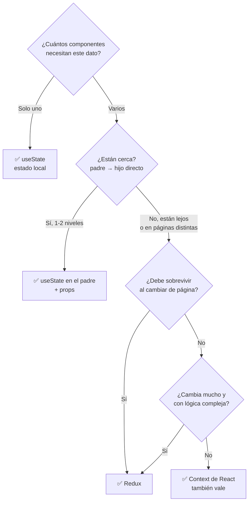

**Ejemplos:**

| Dato | ¿Dónde? | Por qué |
|---|---|---|
| Texto que se escribe en un buscador | `useState` | Solo lo usa el buscador |
| Si un menú desplegable está abierto | `useState` | Detalle visual de un componente |
| Usuario que ha iniciado sesión | **Redux** | Lo necesitan el menú, el perfil, los permisos... |
| Carrito de la compra | **Redux** | Varias páginas lo leen y lo modifican |
| **El contador de este proyecto** | **Redux** | Hermano e Hijo están en páginas distintas |

### ¿Cuándo usar cada pieza?

| Pieza | La necesitas cuando... |
|---|---|
| `configureStore` | **Una vez** por aplicación, al principio |
| `createSlice` | Cada vez que tengas un **tema nuevo** de datos compartidos (usuario, carrito, tema oscuro...) |
| Añadir un reducer al slice | Cada vez que exista una **nueva forma** de cambiar ese dato |
| `PayloadAction<T>` | Cuando la acción necesita **un dato extra** (p. ej. "sumar **5**") |
| `useAppSelector` | En cada componente que necesite **leer** un dato del store |
| `useAppDispatch` | En cada componente que necesite **cambiar** un dato del store |
| `Provider` | **Una vez**, en `main.tsx` |
| `createAsyncThunk` | Cuando tengas que **pedir datos a un servidor** (fetch) y guardarlos en el store |
| `createBrowserRouter` | **Una vez**, para definir todas las páginas |
| `children` + `<Outlet />` | Cuando varias páginas compartan un **marco común** (menú, cabecera) |
| `<Link>` | Cada enlace **interno** de la app |
| `<a href>` | Solo enlaces **externos** (otra web) |

### ¿Por qué cada decisión del proyecto?

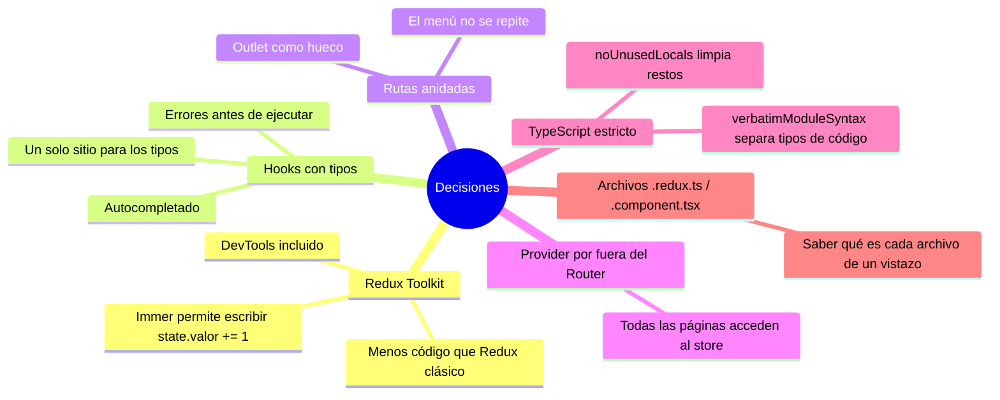

---

## 13. Ejercicios para practicar

Ordenados de más fácil a más difícil. Haz un `git commit` después de cada uno que funcione.

### Ejercicio 1 — Arreglar el build
Haz el [experimento 1](#experimento-1-el-build-falla-error-real-de-este-proyecto). `npm run build` y `npm run lint` deben terminar **sin errores**.

### Ejercicio 2 — Botón "+10"
Añade un reducer `incrementarDiez` que sume 10 y un botón en Hermano que lo use.

<details>
<summary>💡 Pista</summary>

1. En `reducers` del slice: `incrementarDiez: state => { state.valor += 10 }`
2. Expórtalo en la línea de `counterSlice.actions`.
3. Impórtalo en Hermano y añade el botón con `dispatch(incrementarDiez())`.
</details>

### Ejercicio 3 — Sumar una cantidad cualquiera (payload)
Crea `incrementarEnCantidad` que reciba el número a sumar.

<details>
<summary>💡 Solución</summary>

```ts
import { createSlice, type PayloadAction } from '@reduxjs/toolkit'

// dentro de reducers:
incrementarEnCantidad: (state, action: PayloadAction<number>) => {
  state.valor += action.payload
},
```
En el componente:
```tsx
<button onClick={() => dispatch(incrementarEnCantidad(5))}>+5</button>
```
`incrementarEnCantidad(5)` crea `{ type: "contador/incrementarEnCantidad", payload: 5 }`. El **payload** es el "importe" escrito en el formulario.
</details>

### Ejercicio 4 — No repetir código
Crea `src/components/botonesContador.component.tsx` con los tres botones y úsalo dentro de Hermano e Hijo.

### Ejercicio 5 — No bajar de 0
Haz que `decrementar` no permita valores negativos. ¿Dónde va la lógica: en el componente o en el reducer? (Respuesta: **en el reducer**; así la regla se cumple venga el clic de donde venga.)

### Ejercicio 6 — Un segundo slice
Crea `usuarioSlice.redux.ts` con `{ nombre: string }` y una acción `cambiarNombre(texto)`. Regístralo en el store con la clave `usuario`. Muestra el nombre en el menú de `App` y cámbialo desde un `<input>` en Hijo.

### Ejercicio 7 — Página de inicio
Ahora en `/` el `Outlet` está vacío. Añade una ruta hija con `index: true` que muestre un componente `Inicio` con un mensaje de bienvenida y el valor actual del contador.

### Ejercicio 8 — Observar con Redux DevTools
Instala la extensión **Redux DevTools** en tu navegador, abre F12 → pestaña *Redux*, pulsa botones y observa cada acción (`contador/incrementar`...) y el estado. Prueba el botón de "rebobinar" (*time travel*).

---

## 14. Glosario

| Término | Definición sencilla |
|---|---|
| **Action (acción)** | Objeto que describe algo que pasó: `{ type: "contador/incrementar" }` |
| **Action creator** | Función que fabrica acciones: `incrementar()` |
| **Componente** | Función con nombre en mayúscula que devuelve lo que se ve en pantalla |
| **Dispatch** | Enviar una acción al store |
| **Estado (state)** | Los datos en un momento dado |
| **Export default / con nombre** | Formas de compartir cosas entre archivos (con o sin llaves al importar) |
| **Fragmento `<>`** | Envoltorio invisible para devolver varios elementos |
| **Hook** | Función de React que empieza por `use` (`useState`, `useAppSelector`...). Solo se usa dentro de componentes, arriba del todo |
| **Immer** | Librería dentro de Redux Toolkit que permite "mutar" un borrador de forma segura |
| **JSX** | La sintaxis tipo HTML dentro de JavaScript (`<h1>{count}</h1>`) |
| **Mutar** | Cambiar un objeto existente en lugar de crear uno nuevo |
| **npm** | El gestor de paquetes de Node |
| **Outlet** | Hueco donde React Router muestra la ruta hija |
| **Payload** | Dato extra que lleva una acción (`incrementarEnCantidad(5)` → `payload: 5`) |
| **Props** | Datos que un componente padre pasa a un hijo |
| **Prop drilling** | Pasar props a través de muchos componentes que no las usan |
| **Provider** | Componente que hace disponible el store a todos sus descendientes |
| **Reducer** | Función pura `(estado, acción) → estado nuevo` |
| **Selector** | Función que extrae un trozo del estado: `state => state.contador.valor` |
| **Slice** | Trozo del estado + sus reducers + sus acciones, creado con `createSlice` |
| **Store** | El objeto único que guarda todo el estado global |
| **StrictMode** | Modo de React que, en desarrollo, ejecuta cosas dos veces para detectar errores |
| **Tipo / interface** | "Molde" de TypeScript que describe la forma de los datos |
| **Vite** | Herramienta que arranca el servidor de desarrollo y empaqueta el proyecto |

---

## 15. Checklist final

Antes de dar por terminado tu proyecto, comprueba:

- [ ] `node -v` y `npm -v` responden.
- [ ] Ejecuté `npm install` y existe `node_modules`.
- [ ] `npm run dev` arranca y veo el menú.
- [ ] Sumo en Hermano, voy a Hijo y **veo el mismo número**.
- [ ] `npm run build` termina **sin errores**.
- [ ] `npm run lint` termina **sin errores**.
- [ ] `<Provider store={store}>` envuelve al `RouterProvider`.
- [ ] Cada slice está registrado en `configureStore`.
- [ ] La clave del store coincide con la del selector (`contador` ↔ `state.contador`).
- [ ] Uso `useAppSelector` / `useAppDispatch`, no los hooks sin tipos.
- [ ] Todos los `onClick` usan `() => dispatch(accion())`.
- [ ] Ningún hook está dentro de un `if` o un bucle.
- [ ] Navego con `<Link>`, no con `<a href>`.
- [ ] No modifico el estado fuera de los reducers.
- [ ] Hice `git commit` de la versión que funciona.

> 🎓 **Resumen en una frase:** *los componentes **leen** la bóveda con `useAppSelector` y **piden cambios** con `dispatch(accion())`; solo el reducer cambia el estado; y el `Provider` conecta la bóveda a toda la app.*
